# 📞 Awesome Cloud Business Phone & Telephony (PBX) Ecosystem

<p align="center">
  <a href="https://github.com/ishandutta2007/Awesome-Awesome-Awesome"></a>
  <a href="https://discord.gg/jc4xtF58Ve"></a>
  <a href="https://github.com/ishandutta2007/Awesome-Cloud-Business-Phone-Telephony-PBX/stargazers"></a>
  <a href="https://github.com/ishandutta2007/Awesome-Cloud-Business-Phone-Telephony-PBX/network/members"></a>
  <a href="https://github.com/ishandutta2007/Awesome-Cloud-Business-Phone-Telephony-PBX/blob/main/LICENSE"></a>
  <a href="https://github.com/ishandutta2007"></a>
</p>

<p align="center">
  
</p>

<p align="center">
  <strong>A curated list of enterprise SaaS platforms, VoIP solutions, and open-source PBX / SIP / WebRTC projects for modern cloud business phone systems.</strong>
</p>

<p align="center">
  <em>Covers Cloud PBX, Unified Communications (UCaaS), Interactive Voice Response (IVR), SIP Trunking, Call Routing, and Programmable Voice APIs.</em><br>
  <strong>Last updated: March 2026</strong>
</p>

---

## 🧭 Table of Contents
- [📖 Overview & Key Features](#-overview--key-features)
- [📊 Sector Overview & Market Dynamics](#-sector-overview--market-dynamics)
- [💼 SaaS & Hosted Communications Platforms](#-saas--hosted-communications-platforms)
- [🔓 Open-Source Telephony & PBX Projects](#-open-source-telephony--pbx-projects)
- [🛠️ Telephony Stack Architecture](#-telephony-stack-architecture)
- [🤝 How to Contribute](#-how-to-contribute)
- [💖 Support & Community](#-support--community)
- [📈 Star History](#-star-history)
- [⚠️ Disclaimer](#️-disclaimer)

---

## 📖 Overview & Key Features

This repository tracks top-tier **SaaS cloud phone systems** and **open-source business telephony engines** for modern enterprise communications. Business telephony over IP replaces expensive on-premises PBX hardware with scalable, cloud-native services offering:

- 📱 **Virtual Phone Numbers & Global DID**: Local, toll-free, and international routing across 100+ countries.
- 🤖 **Interactive Voice Response (IVR) & Auto Attendants**: Multi-level visual call trees with conversational AI.
- 🔀 **Intelligent Call Routing & Queuing**: Skills-based routing, ring groups, and automated rollover queues.
- 🎙️ **Call Recording & Transcription**: Real-time speech-to-text, voicemail transcription, and sentiment analytics.
- 💬 **Omnichannel & UCaaS**: Integrated voice, HD video conferencing, team chat, SMS/MMS, and CRM hooks.
- 🔌 **SIP Trunking & Programmable Voice**: Carrier-grade edge routing, WebRTC gateways, and RESTful APIs.

---

## 📊 Sector Overview & Market Dynamics

The global Cloud PBX and Unified Communications as a Service (UCaaS) market is currently valued between **$66 billion and $106 billion**, and is projected to expand beyond **$125+ billion by 2026** at a robust CAGR of ~17% to 20% (with core Cloud PBX/telephony software contributing ~$18B to $29B).

The sector presents a **moderately concentrated market structure** characterized by enterprise consolidation at the top and an expansive long tail:
- **Tier-1 Dominance**: Global enterprise seat volume is heavily led by giants including Microsoft Teams Phone, Zoom Phone, Cisco Webex, Twilio, and RingCentral.
- **Fragmented Long Tail**: A vast ecosystem of regional carriers, open-source operators, and white-label PBX distributors thrives worldwide by addressing stringent data residency regulations, localized telecom compliance, and affordable SMB voice requirements.

---

## 💼 SaaS & Hosted Communications Platforms

The table below catalogs leading commercial cloud phone and business PBX services, sorted in descending order by **Company Size (Valuation / Revenue)**:

| Product | Company Size (Valuation / Revenue) | Description | Pricing (Starting) | Free Tier / Trial Limits |
|:---|:---|:---|:---|:---|
| **[Zoom Phone](https://www.zoom.us/)** | ~$25B Market Cap (~$4.67B Rev) | Cloud PBX natively integrated into Zoom Meetings. Includes desk phone support, call recording, and Zoom AI Companion. | Metered Plan: $10/user/month; Unlimited Plan: $15/user/month (annual billing) | **No permanent free tier**; 14-day free trial (up to 100 minutes with Virtual Agent Receptionist) |
| **[Twilio Voice](https://www.twilio.com/voice)** | ~$21.6B Market Cap (~$4.4B Rev) | Enterprise programmable voice API platform for custom call flows, interactive IVRs, and global SIP trunking. | Inbound: $0.0085/min; Outbound: $0.014/min (US); Virtual DID numbers: $1.15/month | **No permanent free tier**; **$15 free trial credit** on signup with 1 provisioned phone number |
| **[Talkdesk](https://www.talkdesk.com/)** | ~$10B Valuation (~$420M ARR) | AI-powered enterprise contact center (CCaaS) and cloud voice platform featuring workforce engagement and routing. | Talkdesk Express: $25/user/month; CX Cloud Digital Essentials: $85/user/month; Voice Essentials: $105/user/month | **No permanent free tier**; **15-day free trial** capped at 10 users and $100 calling credits |
| **[Vonage Business Communications](https://www.vonage.com/)** | ~$6.2B Enterprise Value (~$1.4B Rev) | Cloud PBX platform (Ericsson) with desktop/mobile apps, unlimited calls/SMS, auto attendant, and meetings up to 200 users. | Mobile Plan: $13.99/line/month (annual) or $19.99/line/month (month-to-month); Premium: $20.99/line/month | **No permanent free tier**; **14-day free trial** (up to 99 lines, US only, online purchase) |
| **[GoTo Connect](https://www.goto.com/)** | ~$4.3B Valuation (~$1.3B Rev) | Unified communications platform bundling cloud phone system, video conferencing, team chat, and multi-tier auto attendants. | Phone System: $26/user/month; Connect CX: $34/user/month; Contact Center: $80/user/month | **No permanent free tier**; **14-day free trial** with full access to cloud phone and meeting features (no credit card required) |
| **[Freshcaller](https://www.freshworks.com/freshcaller-cloud-pbx/)** | ~$3.5B Market Cap (~$700M+ Rev) | Cloud PBX and contact center within the Freshworks suite, featuring IVR, call routing, voicemail, and CRM integration. | Growth: $15/agent/month (billed annually); Pro: $29/agent/month; Enterprise: $49/agent/month | **Free Forever Plan**: 2 agents, 2 concurrent incoming calls, US/Canada local numbers, 500 inbound minutes/month |
| **[RingCentral MVP](https://www.ringcentral.com/)** | ~$2.5B Market Cap (~$2.4B Rev) | Flagship enterprise UCaaS providing unlimited domestic calling, HD video meetings, team messaging, AI notes, and SMS. | Core: $20/user/month (annual) or $30/user/month (monthly); Advanced: $25/user/month; Ultra: $35/user/month | **No permanent free tier**; **14-day free trial** capped at 5 users and 50 minutes of domestic calling per user |
| **[Nextiva](https://www.nextiva.com/)** | ~$2.7B Valuation (~$300M+ Rev) | Cloud VoIP and UCaaS platform designed for SMBs and mid-market teams, featuring call routing, video, and CRM sync. | Digital: $20/user/month; Core: $30/user/month (billed annually) or $35/user/month (monthly); Engage: $40/user/month | **No permanent free tier**; 7-day demo trial upon request; standard 30-day money-back guarantee |
| **[Dialpad](https://www.dialpad.com/)** | ~$2.2B Valuation (~$365M ARR) | AI-first workspace communications combining cloud voice, video meetings, SMS, real-time transcription, and live sentiment analysis. | Standard: $15/user/month (billed annually) or $23/user/month (monthly); Pro: $25/user/month; Enterprise: $35/user/month | **No permanent free tier**; **14-day free trial** on Standard plan including unlimited US/Canada calling and AI transcription |
| **[8x8](https://www.8x8.com/)** | ~$275M Market Cap (~$730M Rev) | Cloud communications and voice platform featuring business phone service, international calling zones, and contact center tools. | 8x8 Express: $15/user/month; X2 Work: $24/user/month (annual) or $28/user/month (monthly); X4 Work: $44/user/month | **No permanent free tier**; **30-day free trial** on 8x8 Express with 1 business phone number and unlimited US/Canada calling |

---

## 🔓 Open-Source Telephony & PBX Projects

Open-source telephony grants system administrators, telecommunication engineers, and developers complete control over call routing, security, media processing, and privacy without recurring per-seat subscription fees.

The table below is sorted in descending order by **GitHub Stars_Count**:

| Project | GitHub_Stars | Description |
|:---|:---|:---|
| **[Jitsi Meet](https://github.com/jitsi/jitsi-meet)** | [](https://github.com/jitsi/jitsi-meet/stargazers) | Fully encrypted, 100% open-source video conferencing and voice solution used as a standalone telephony/meeting server or embedded via WebRTC. |
| **[LiveKit](https://github.com/livekit/livekit)** | [](https://github.com/livekit/livekit/stargazers) | End-to-end WebRTC stack and real-time audio/video infrastructure designed for scalable real-time voice, telephony egress/ingress, and AI voice agents. |
| **[coturn](https://github.com/coturn/coturn)** | [](https://github.com/coturn/coturn/stargazers) | Free open-source implementation of TURN and STUN Server for VoIP, SIP NAT traversal, WebRTC media relay, and real-time media routing. |
| **[Fonoster](https://github.com/fonoster/fonoster)** | [](https://github.com/fonoster/fonoster/stargazers) | The open-source alternative to Twilio. An innovative programmable telecommunications stack for deploying cloud PBX, programmable voice apps, and IVR workflows. |
| **[FreeSWITCH](https://github.com/signalwire/freeswitch)** | [](https://github.com/signalwire/freeswitch/stargazers) | Highly scalable, modular multi-protocol real-time communications engine powering voice, WebRTC, video, and conferencing platforms worldwide. |
| **[Asterisk](https://github.com/asterisk/asterisk)** | [](https://github.com/asterisk/asterisk/stargazers) | The industry-standard open-source PBX toolkit powering millions of corporate phone systems. Provides call routing, IVR, voicemail, SIP, and conference bridging. |
| **[Kamailio](https://github.com/kamailio/kamailio)** | [](https://github.com/kamailio/kamailio/stargazers) | High-performance open-source SIP server handling thousands of call setups per second. Serves as carrier-grade SIP proxy, registrar, SBC, and load balancer. |
| **[PJSIP](https://github.com/pjsip/pjproject)** | [](https://github.com/pjsip/pjproject/stargazers) | Comprehensive, footprint-optimized multimedia communication library implementing standard SIP, SDP, RTP, RTCP, and WebRTC protocols. |
| **[baresip](https://github.com/baresip/baresip)** | [](https://github.com/baresip/baresip/stargazers) | Modular, lightweight, portable SIP user agent with audio and video support, ideal for softphones, IoT voice endpoints, and embedded VoIP devices. |
| **[HOMER](https://github.com/sipcapture/homer)** | [](https://github.com/sipcapture/homer/stargazers) | Telephony capture and monitoring system providing real-time VoIP packet inspection, SIP ladder diagrams, and QoS/QoE diagnostics. |
| **[OpenSIPS](https://github.com/OpenSIPS/opensips)** | [](https://github.com/OpenSIPS/opensips/stargazers) | Ultra-fast SIP proxy/server for carrier voice architectures, wholesale SIP trunking, call routing engines, and session border controller (SBC) roles. |
| **[sngrep](https://github.com/irontec/sngrep)** | [](https://github.com/irontec/sngrep/stargazers) | Terminal-based SIP packet flow viewer and call debugging tool. Visualizes SIP message flows in real-time right inside your SSH session. |
| **[FusionPBX](https://github.com/fusionpbx/fusionpbx)** | [](https://github.com/fusionpbx/fusionpbx/stargazers) | Feature-complete multi-tenant PBX management GUI built on top of FreeSWITCH. Delivers carrier-grade hosted PBX functionality with modern web administration. |
| **[rtpengine](https://github.com/sipwise/rtpengine)** | [](https://github.com/sipwise/rtpengine/stargazers) | High-throughput RTP/SRTP media proxy designed by Sipwise for Kamailio and OpenSIPS to bridge WebRTC audio and standard VoIP streams. |
| **[Linphone Desktop](https://github.com/BelledonneCommunications/linphone-desktop)** | [](https://github.com/BelledonneCommunications/linphone-desktop/stargazers) | Modern open-source SIP desktop softphone featuring end-to-end encryption, HD voice/video, call transfer, and multi-account capabilities. |
| **[drachtio Server](https://github.com/drachtio/drachtio-server)** | [](https://github.com/drachtio/drachtio-server/stargazers) | High-performance SIP signaling engine with a Node.js/JavaScript application framework for developing custom programmable telecom applications. |
| **[FreePBX Core](https://github.com/FreePBX/core)** | [](https://github.com/FreePBX/core/stargazers) | Web GUI and core management engine for Asterisk. Provides modular extension setup, trunking, IVR, and voicemail routing. |
| **[Issabel](https://github.com/IssabelFoundation/issabel)** | [](https://github.com/IssabelFoundation/issabel/stargazers) | Unified communications distribution combining Asterisk, web management, call center reporting, CRM connectors, and video meetings. |
| **[VitalPBX VPS](https://github.com/VitalPBX/VPS)** | [](https://github.com/VitalPBX/VPS/stargazers) | Automated deployment and administration scripts for VitalPBX, a multi-tenant commercial open-source PBX platform based on Asterisk. |

---

## 🛠️ Telephony Stack Architecture

When architecting a production self-hosted PBX or enterprise telephony system, industry best practices organize components into distinct layers:

1. **Edge & Security Layer**:
   - **[Kamailio](https://github.com/kamailio/kamailio)** or **[OpenSIPS](https://github.com/OpenSIPS/opensips)** acting as an edge Session Border Controller (SBC), handling DDoS protection, TLS/SRTP termination, and NAT traversal.
   - **[coturn](https://github.com/coturn/coturn)** for reliable STUN/TURN media relay across restrictive enterprise firewalls.
2. **Media & Relay Layer**:
   - **[rtpengine](https://github.com/sipwise/rtpengine)** for kernel-accelerated RTP forwarding, transcoding, and WebRTC-to-SIP bridging.
3. **PBX Switching & Application Layer**:
   - **[Asterisk](https://github.com/asterisk/asterisk)** (paired with **[FreePBX](https://github.com/FreePBX/core)**) or **[FreeSWITCH](https://github.com/signalwire/freeswitch)** (paired with **[FusionPBX](https://github.com/fusionpbx/fusionpbx)**) managing business logic, IVRs, voicemail, and extensions.
   - **[Fonoster](https://github.com/fonoster/fonoster)** or **[drachtio](https://github.com/drachtio/drachtio-server)** for modern programmable voice applications and serverless microservices.
4. **Monitoring & Diagnostic Layer**:
   - **[sngrep](https://github.com/irontec/sngrep)** for live CLI packet flows and **[HOMER](https://github.com/sipcapture/homer)** for automated PCAP capture and audio quality metrics (MOS).

---

## 🤝 How to Contribute

Contributions are warmly encouraged! Help keep this telephony resource accurate, comprehensive, and up-to-date:

1. 🍴 **Fork the Repository** on GitHub.
2. 🌿 **Create a Feature Branch** (`git checkout -b feature/add-new-pbx-project`).
3. 📝 **Add or Update Entries**: Ensure descriptions are factual, pricing is verified, and GitHub Stars_Badges follow the standard format:
   ```markdown
   [](https://github.com/{owner}/{repo}/stargazers)
   ```
4. 🚀 **Commit and Push** your changes with clear commit messages.
5. 📬 **Submit a Pull Request** describing the addition.

---

## 💖 Support & Community

If you find this repository helpful for your business, telecom architecture, or VoIP engineering research:

- ⭐ **Star the Repository** on GitHub to increase visibility for the community!
- 🍴 **Fork and Share** it with your fellow sysadmins, DevOps engineers, and VoIP specialists.
- 💬 **Join our Discord** at [discord.gg/jc4xtF58Ve](https://discord.gg/jc4xtF58Ve) to discuss cloud telephony, SIP setups, and open-source PBX stacks.
- ☕ **Support Ongoing Maintenance**: You can buy a coffee or sponsor our work directly via the **[GitHub Sponsor Dashboard](https://github.com/sponsors/ishandutta2007)**. Thank you for your generous encouragement and support!

---

## 📈 Star History

[](https://www.star-history.com/#ishandutta2007/Awesome-Cloud-Business-Phone-Telephony-PBX&type=date&legend=top-left)

---

## ⚠️ Disclaimer

- This is an independent, **community-curated** reference list — inclusion does not imply official endorsement.
- Cloud PBX systems process real-time voice communications and call recordings. Ensure strict compliance with applicable privacy regulations (e.g., GDPR, HIPAA, wiretapping and call recording consent laws) and enforce multi-factor authentication (MFA) across administrator dashboards.
- Self-hosted telephony stacks require vigilant firewall configurations, SIP anti-abuse protections (e.g., Fail2Ban, rate-limiting, TLS/SRTP), and strong SIP passwords to prevent toll fraud and eavesdropping.

---

<p align="center">
  <strong>Crafted with ❤️ for IT Administrators, VoIP Engineers, System Architects, and Telecom Enthusiasts worldwide.</strong>
</p>
